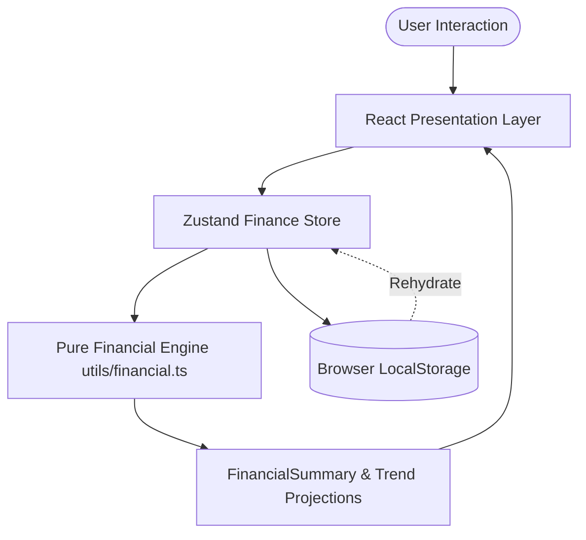
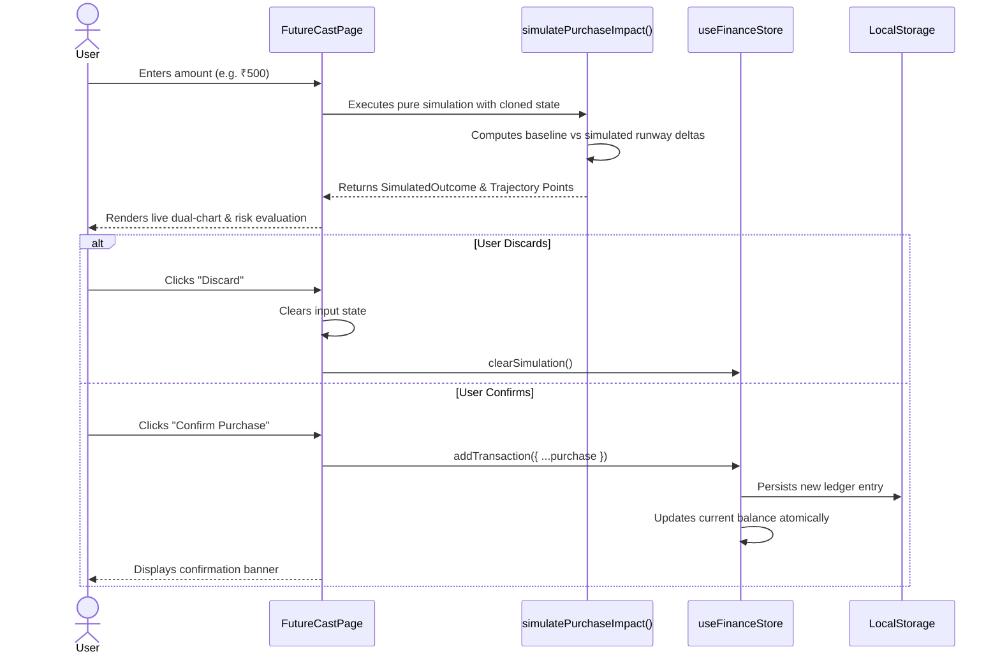

# System Architecture Document (SAD) — RupeeRadar

## 1. System Overview & Architectural Paradigm

RupeeRadar is designed as a **modular, client-side reactive web application** that guarantees sub-second responsiveness, complete offline privacy, and zero server latency.

The system follows a strict **unidirectional data flow**:
1. User interactions dispatch actions to a centralized **Zustand Store**.
2. State mutations trigger pure deterministic recalculations in the **Financial Calculation Engine**.
3. Computed financial summaries flow reactively to **React Presentation Components**.
4. The store automatically serializes state changes to **Browser LocalStorage** via versioned persistence middleware.



---

## 2. Layered Architecture & Component Hierarchy

```
┌─────────────────────────────────────────────────────────────┐
│                    Presentation Layer                       │
│  App Shell · Header · Sidebar · MobileNav · Modal Dialogs   │
├─────────────────────────────────────────────────────────────┤
│                       Page Screens                          │
│  DashboardShell · TransactionsPage · BillsPage             │
│  SavingsPage · FutureCastPage (Decision Simulator)          │
├─────────────────────────────────────────────────────────────┤
│                    Application State Layer                  │
│  useFinanceStore (Zustand 5.0) · LocalStorage Middleware    │
├─────────────────────────────────────────────────────────────┤
│                  Domain Calculation Engine                  │
│  calculateFinancialSummary · simulatePurchaseImpact        │
│  calculateTrendHistoryAndProjection · Input Validators      │
├─────────────────────────────────────────────────────────────┤
│                     Data Models & Types                     │
│  Transaction · Commitment · SavingsGoal · SimulationState   │
└─────────────────────────────────────────────────────────────┘
```

### Module Responsibilities

| Path | Responsibility | State Mutation |
| :--- | :--- | :---: |
| `src/types/index.ts` | Pure TypeScript interfaces, domain models, and expense categories. | None |
| `src/utils/financial.ts` | Stateless deterministic financial calculations and input validation rules. | None (Pure Functions) |
| `src/store/useFinanceStore.ts` | Centralized state management, atomic CRUD operations, persistence, and schema migration. | Mutates Store State |
| `src/components/common/` | Reusable design primitives (`Button`, `Card`, `Badge`, `Modal`). | Local UI State Only |
| `src/components/dashboard/` | Data presentation widgets (`BalanceCard`, `MoneyPulseChart`, `SpendingBreakdown`). | Read-Only Selectors |
| `src/pages/` | Primary feature screens; handles user workflows and modal lifecycle. | Dispatches Store Actions |

---

## 3. Financial Calculation Engine Specification

The financial engine (`src/utils/financial.ts`) acts as the single source of truth across all views. It operates entirely as pure functions with zero side-effects.

### Core Mathematical Formulas

$$\text{Total Expenses} = \sum_{t \in \text{Transactions}, t.\text{type} = \text{'expense'}} t.\text{amount}$$

$$\text{Total Income} = \sum_{t \in \text{Transactions}, t.\text{type} = \text{'income'}} t.\text{amount}$$

$$\text{Current Ledger Balance} = \text{Starting Budget} + \text{Total Income} - \text{Total Expenses}$$

$$\text{Committed Bills} = \sum_{c \in \text{Commitments}, \neg c.\text{isPaid}} c.\text{amount}$$

$$\text{Locked Savings} = \sum_{s \in \text{SavingsGoals}} s.\text{currentAmount}$$

$$\text{Safe Available Balance} = \text{Current Ledger Balance} - \text{Committed Bills} - \text{Locked Savings}$$

$$\text{Days Remaining} = \max(1, \text{Total Days} - \text{Current Day} + 1)$$

$$\text{Safe Daily Allowance} = \begin{cases} \lfloor \frac{\text{Safe Available Balance}}{\text{Days Remaining}} \rfloor & \text{if } \text{Safe Available Balance} > 0 \\ 0 & \text{otherwise} \end{cases}$$

$$\text{Daily Burn Rate} = \frac{\text{Total Expenses}}{\max(1, \text{Current Day})}$$

$$\text{Projected Month-End} = \text{Current Ledger Balance} - (\text{Daily Burn Rate} \times \max(0, \text{Total Days} - \text{Current Day}))$$

$$\text{Financial Health Score} = \text{Weighted composite of Runway Ratio (50%) + Savings Buffer (30%) + Bill Coverage (20%)}$$

---

## 4. FutureCast Simulation Architecture

FutureCast is RupeeRadar's signature decision simulation engine. It allows users to test the impact of discretionary spending without polluting real ledger balances.



### Simulation Isolation Guarantees
1. **Zero Premature Persistence**: Hypothetical purchases are evaluated in ephemeral memory. No transaction IDs or ledger modifications occur during preview.
2. **Dual-Trajectory Projection**: Generates 30-day projection points for both the baseline runway and simulated runway simultaneously.
3. **Atomic Confirmation**: When confirmed, `addTransaction` executes synchronously, deduplicating submissions and invalidating stale simulation state.

---

## 5. Persistence & Schema Migration

State persistence is managed via Zustand's `persist` middleware backed by `window.localStorage` under the storage key `'rupeeradar-storage'`.

```typescript
{
  name: 'rupeeradar-storage',
  version: 1,
  migrate: (persistedState: unknown, version: number) => {
    // Guards against corrupted or outdated schema shapes
    if (version === 0 || !persistedState) {
      return DEFAULT_FALLBACK_STATE;
    }
    return persistedState as FinanceStoreState;
  }
}
```

---

## 6. Performance & Asset Optimization

1. **Vendor Chunk Splitting**: Configured manual chunking in `vite.config.ts`:
   - `vendor-react` (`react`, `react-dom`): 173 kB (54 kB gzip)
   - `vendor-charts` (`recharts`, `d3-*`): 392 kB (106 kB gzip)
   - `vendor-icons` (`lucide-react`): 18 kB (4 kB gzip)
   - `index` (Application logic): 108 kB (23 kB gzip)
   - *Eliminates monolithic bundle warnings and maximizes browser HTTP/2 parallel caching.*
2. **Stateless Component Extraction**: Recharts custom tooltip components are extracted to module-level scope to avoid recreation on parent re-renders.
3. **Memoized Derivations**: Complex projections in `FutureCastPage` and `DashboardShell` are wrapped in `useMemo` hooks, executing only when dependency references change.

---

## 7. Accessibility (a11y) Architecture

1. **Modal Dialogs (`role="dialog"`, `aria-modal="true"`)**:
   - Focus trap cycles keyboard focus strictly between focusable children.
   - Restores focus to the triggering element upon closure.
   - Closes on `Escape` keydown and unlocks body scroll.
   - Connected via `aria-labelledby` to dialog header title.
2. **Navigation Landmarks**:
   - Sidebar and MobileNav utilize `<nav>` landmark semantics with `aria-label` and `aria-current="page"` cues.
3. **Data Visualizations**:
   - Recharts SVG containers are wrapped in accessible containers with `role="img"` and descriptive `aria-label` attributes reciting actual numerical summaries.
4. **Form Controls**:
   - Every input and select is explicitly linked to a corresponding `<label>` using unique `htmlFor` and `id` bindings.
